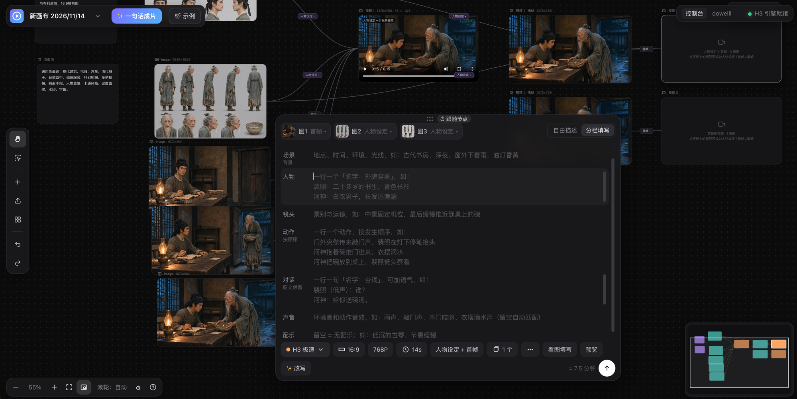

# OneShot

[简体中文](README.md)

[](LICENSE)

OneShot is a self-hosted AI video production workspace. Start with a one-line idea to generate a script, character designs, and storyboards, or bring existing images, clips, and text into the canvas to generate, revise, and edit shots into a film.

Run MiniMax-H3 and H3-Image locally, or use the web console to connect third-party model services, manage accounts, and inspect jobs.

Choose Chinese or English on the sign-in page, in the upper-right corner of the canvas, or in the console. Your browser saves your language preference.



## Features

- **Idea to Film** takes an idea or template through scriptwriting, character reference images and voice descriptions, storyboards, video generation, and final editing. Revise the script shot by shot and generate multiple takes for each shot.
- **Canvas** supports text, image, video, and storyboard script nodes. Link nodes to use them as references. Structured video prompt fields cover style, setting, characters, camera, action, dialogue, sound, and music, and are combined into H3's prompt format.
- **Canvas documents** let you write scripts and shot notes directly from a text node. Edit plain text or Markdown with formatting tools, live preview, and background colors. Saving the full text to the asset library retains formatting when brought back onto the canvas. Public snapshots and their copies retain the published Markdown and background color. Connected image and video nodes can reference the document text.
- **File import** accepts file selection, drag and drop, and files from the clipboard. Import images, video, audio, TXT, Markdown, CSV, JSON, DOCX, and PDF together. Documents become editable text, Markdown retains its formatting, and a batch can be undone in one step.
- **Workflow templates** include storyboards, product images, first-and-last-frame clips, and character turnarounds. Preview linked media versions and reference times, then customize the brief, prompts, and shot settings for your copy. Insert into the current canvas or create a canvas in a selected project. Review the generation plan before submitting. Favorites follow your account. Save canvas groups as templates, add instructions, and share with signed-in OneShot users. Authors can update a shared template without changing its link and restore any of the 20 most recent revisions. Copies retain nodes, groups, links, and generation settings. When saving a selection, you can include upstream assets and their pinned versions.
- **Creative apps** in the left toolbar and Creative Assistant describe each task's inputs, examples, and expected deliverables. Some link to related workflow templates. Choosing an example or entering a brief adds it to the current conversation draft for review.
- **Web research** in the Creative Assistant searches public web pages and Wikimedia Commons images. Results include source links. Add source notes or images with attribution and licensing information to the canvas. Configure Brave Search in the console for date filters. OneShot uses DuckDuckGo when no web search provider is configured and can fall back to encyclopedia search when the service is unavailable.
- **Conversation models** can be chosen before the first message. Automatic selection uses the platform's model routes and fallbacks. A manually selected model stays fixed for that conversation. Models that support reasoning effort let you set it per message. Queued messages retain the effort selected at submission.
- **Creative confirmations** collect the assistant's questions above the composer. Select or enter your answers and submit them together to resume the task. The conversation retains your answers.
- **Production review** in the canvas menu or a node's context menu traces saved references, prompts, generation parameters, and timeline clips. Jump to the material or export the record as Markdown. The Creative Assistant can read the same record.
- **3D blockouts** let you position characters and simple props from above, keyframe cameras and blocking on a timeline, and render silent MP4 previews. Each video version retains an editable scene. [Blockout guide](docs/previs.md)
- **Projects with multiple canvases** let you create projects, move existing canvases into them, and open another canvas from the top bar. Search by name or create canvases in your personal or team space. Changes save before switching, and failed saves can be retried next to the canvas name. Project grouping is private to its creator. Sharing permissions remain with each canvas, and dissolving a project returns its canvases to the standalone list.
- **Canvas search** finds nodes, groups, and past prompts with ⌘/Ctrl + F. Use the arrow keys to select a result and Enter to jump to it. Preview matching historical versions and use color markers to find nodes with the same color.
- **Canvas directory** in the console supports search, personal/team/shared filters, name and date sorting, and grid and list views. Move or delete owned canvases in batches, drag them into a project, or drag two canvases together to create a project. Older canvases with unknown creation dates are marked.
- **Generation history** in the left toolbar lets you find your generated images, videos, and audio by name, prompt, model, media type, or current canvas. If the source file still exists, place it back on the canvas or download it in a bundle even after deleting its node. Multi-selection persists across filters, queries, and pages. Placing a batch can be undone in one step.
- **Batch downloads** work with canvas selections, groups, and generation history. The transfer panel shows packaging and download progress. Duplicate files are included once, and a single downloadable file is sent directly.
- **Asset library multi-selection** collects selected canvas assets into a chosen scope and folder. Press L to open the library, drag single or multiple assets onto the canvas, or download and archive assets in batches. Batch placement can be undone in one step and retains text formatting.
- **Favorites** save the current image, video, or audio version from the node toolbar or generation history. Access it from other canvases through My favorites. Favorites belong to the account and follow the original media permissions.
- **Full-screen version review** lets you browse all versions of an asset. For images, hold the backslash key to see the previous version and release it to return. Place the previewed version on the canvas and keep browsing or jump to the new node. The original node retains its links and versions.
- **AI watermarking** is an opt-in account setting in the Projects and Canvases menu. Later image and video jobs include a visible mark in the exported file, including downloads and shares. The setting is off by default.
- **Start from a brief** in the canvas directory to create a canvas and open the matching assistant conversation in one step. Start in a personal project or a team space. Image and video generation ask for confirmation. You can also create a team canvas directly from the directory or canvas menu.
- **Team canvases** let you add existing accounts to a named team from Share → Manage teams. Canvas owners can move canvases into a team or back to their personal space. Team members can edit or collaborate live. Explicit review permissions take precedence over team permissions.
- **Canvas comments** can be placed with C or the context menu, either on an empty area or on a node. The Comments panel shows threads, replies, and locations. Comment authors and canvas owners can resolve or reopen threads. Comments and markers update live during collaboration, including when the panel is closed.
- **Canvas sharing** invites existing OneShot accounts as reviewers or editors. Reviewers can view and comment. Editors can make changes. Publish a revocable snapshot that guests can view and signed-in users can copy. Snapshots retain the text, visible assets, and layout at publication.
- **Share a work or conversation** lets you preview a media version or one of your own conversations and publish a link without a sign-in requirement for viewers. Conversation links expose only the previewed text, with a choice of the latest 20 or 50 messages. Links can be revoked.
- **Showcase** accepts a canvas video version or a local MP4, MOV, or WebM up to 300 MB. Choose a cover, including the video’s first frame, and submit for review. You can attach a copyable canvas and your shared workflow templates. Approved films are public and appear in the creator’s profile. Signed-in viewers can preview a template, place it on a canvas, or create an editable copy. Authors can update linked templates, review submissions, or withdraw entries. On a public canvas, signed-in viewers can ask the Creative Assistant to explain how the film was made using the published nodes, links, and text.
- **GIF showcase** accepts looping GIFs from preview, assistant result cards, or local uploads. Once approved, visitors can filter for GIFs, play them, and download them from the work page.
- **Public prompts** can be previewed or edited before you submit a work. After approval, visitors can copy the prompt, and signed-in viewers can use it to create a private video draft. Authors can withdraw the prompt independently of the work.
- **Creative events** let administrators set themes, entry dates, tracks, duration limits, per-person limits, and judging criteria. Registration approval is optional. Creators can submit an existing public work, a canvas video, or a local file. New works pass showcase review before event review. Administrators can publish results and winners after submissions and review are complete.
- **Live canvas collaboration** shows who is online, their cursors, and who is presenting. Follow another user's view and zoom, then stop following from the toolbar or by moving the canvas. Cursor sharing can be turned off and applies only during the session. Independent additions and links to different targets can merge. Review conflicting changes and save to the original canvas or a private copy. Undo and redo retain compatible history and stop at conflicting edits.
- **Creative Assistant** uses a text model configured in the console to operate on the canvas over multiple turns. Select nodes or reference assets with `@` to analyze images, generate or edit them, remove backgrounds, crop, adjust color, create text, or arrange the canvas. Preview thumbnails and pin versions before sending. Operation cards provide live progress, result locations, cancellation, recovery, and undo. The assistant also supports Markdown, protected-region repainting, waiting for manual selections, layers, comparisons, reused settings, video generation, and keyframe replacement. Edits usually append versions in the same node. Video versions restore their inputs and parameters. A turn supports up to four images, one video, 16 tool calls, and 30 minutes. [Assistant guide](docs/agent-chat.md)
- **Image and shot tools** include orthographic views, nine-panel grids, camera-angle changes, grid splitting, high-resolution repainting, prompt extraction, and shot-by-shot analysis and reconstruction.
- **Image shortcuts** are searchable by typing `/` in a prompt. Navigate with the arrow keys and select with Enter or Tab. The nine-angle grid uses the first connected image and current generation settings and preserves the node's prompt. Split the grid into nine images from the result toolbar.
- **Video remake** maps source cast members to asset library characters. Portrait phone footage keeps its displayed orientation through frame extraction, marking, and export. Use vision suggestions and reviewed selections to batch-generate first frames, then generate shot videos from approved frames. Review time-coded action and camera notes, adjust cuts frame by frame, and correct tracking in both directions from correction frames. Local H3 can keep the source footage before a character enters or after they exit. Review each shot with the original sound, protect foreground elements, and export using approved cuts with source audio. Put reviewed shots or the finished film back onto the canvas and switch takes using version tabs. [Remake videos by chatting with the assistant](docs/agent-chat.md#用对话重制现有视频)
- **Image editing** supports brush and rectangle selections, erase and invert, localized repainting, whole-image text edits, and expansion on all four sides. Crop, rotate, flip, adjust brightness, contrast, and saturation, compare the original, and switch versions. AI edits use the configured image service. Mask compositing protects pixels outside the selection. [Image editing guide](docs/image-editing.md)
- **Camera angle for images** lets you drag a camera on the diagram or select presets such as side, rear, or high angle. Set focal length, distance, and framing independently. Candidate images stay in the same node's version tabs.
- **Image dimensions** can be set to a specific width and height. Options include locking the aspect ratio, transparent padding, center cropping, and stretching. The assistant can append the result to the source node as a new version.
- **Panorama preview** opens an approximately 2:1 equirectangular image in a 360° viewer. Drag to look around, scroll to change the field of view, and save the current view as an image node.
- **Shot depth references** generate a grayscale depth video for a selected remake shot. Preview, download, or link it back to the source on the canvas. The host needs Video Depth Anything Small. [Depth setup and usage](docs/video-depth.md)
- **Collapsible groups** hold selected nodes. Drag nodes into a collapsed card or merge two cards. External connections stay visible. Open the card to preview its contents or drag a node back out. Download, collect assets, or reference group media from the assistant.
- **Batch result layout** is saved per canvas and applied at submission. Results normally become versions of the source node. Images or videos can also be placed in a row or collapsed into a group.
- **Reuse historical versions** by dragging a media version tab onto the canvas or choosing to copy it as a standalone node. Use the arrow keys when a tab has focus. The source retains its versions and references, and production review records the copy's source. Video nodes can also move out one version or split all versions into separate nodes.
- **Run a group** shows reference materials, pinned versions, video ranges, estimated output count, and skipped nodes before confirmation. Fill empty nodes or rerun all generation nodes. New images can feed downstream nodes, with outputs saved in their respective version tabs. Track jobs by node, stop further submissions, or retry unfinished nodes. Refreshing or returning to the canvas in the same browser tab restores recorded progress. Later submissions require renewed confirmation.
- **Editing workspace** supports zoom and pan, draft recovery, selection undo/redo, split and side-by-side comparison, parameter reuse and retry, transparent layers, SAM2 subject selection, cutouts, native SD masked repainting, floating panels, canvas alignment and distribution, grouping, and batch ZIP downloads. Prepare additional models on the 4090 with `python scripts/fetch_editor_models.py`.
- **Timeline editor** exports into the original video node as a new version and saves the timeline for later edits. Select multiple images or clips to create a standalone film. Set still durations, reorder, trim, split, change speed from 0.5× to 2×, and add transitions, subtitles, music, narration, and a cover. [Timeline guide](docs/video-reference.md#剪辑后保存为视频版本)
- **Source-audio subtitles** transcribe selected video ranges. Correct the words and timing, preview each line, and burn the subtitles into the export. [Subtitle guide](docs/video-reference.md#从视频原声识别字幕)
- **On-screen titles** add titles and location labels at specific times. Choose placement and styling and preview before export. [Title guide](docs/video-reference.md#添加片头和地名条)
- **Cutaways** overlay an image or video on a selected time range while retaining the main timeline's sound and duration. [Cutaway guide](docs/video-reference.md#添加补画面)
- **Animated B-roll** can be started from a node or requested through the assistant with a pinned source version. It supports animated titles, caption cards, bar charts, and image zooms. Review the source version, timing, and content before creating a linked video node.
- **Playlists** save a reorderable, trimmable collection for continuous shot review. Download the originals, download a combined MP4, export to a standalone film node, or save the combined film as a playlist version. [Playlist guide](docs/video-reference.md#用播放列表连续审片)
- **Canvas audio** supports generation and upload for narration, dialogue, music, and sound effects. Preview, download, and switch versions before adding audio to a timeline or using it as a Seedance reference. [Audio guide](docs/audio-reference.md)
- **Audio waveforms** let you scrub or jump 10 seconds in a node or full-screen view. The waveform belongs to the selected audio version.
- **Audio transcription and dialogue editing** let you preview and transcribe a selected audio version and time range. Correct the dialogue, export time-coded results as SRT, or select lines and cut them into a new audio version with a matching transcript. Narration captions in the timeline follow the matching audio when it is moved or trimmed.
- **Video references** use selected ranges from uploaded clips, films, or generation results. Describe the action, camera move, or composition to reuse. Combine video with images, audio, and blockouts. Pinned versions and edit points stay with the film. [Video reference guide](docs/video-reference.md)
- **Extend video** adds a segment before or after an existing clip. Send the source and extension to the timeline in the correct order. [Video extension guide](docs/video-reference.md#补拍片头或续拍片尾)
- **Trim and split shots** by setting a keep range, splitting at the playhead, or detecting visible cuts. Confirm to create standalone video nodes while keeping the source. [Shot splitting guide](docs/video-reference.md#裁剪视频与拆镜头)
- **Frame capture** saves a frame from the canvas or timeline as a linked image node. You can also ask the assistant to capture a frame at a specific time. [Frame capture guide](docs/video-reference.md#截帧到画布)
- **Segment editing** applies an edit description to a selected video range. Compare the original sections and the edited result in the timeline. [Segment editing guide](docs/video-reference.md#修改视频中的一段)
- **Shot retakes** let you configure camera position, framing, and movement for several ranges, submit them together, and review each result against the source. [Retake guide](docs/video-reference.md#镜头重拍)
- **Asset library and creative memory** organize characters, locations, props, styles, and background material. Upload files, collect from the canvas, search by name or tag, reuse across projects, and share with a team. Assets can retain media versions, a default reference image, and generation history. Copy to your personal library or download descriptions, documents, and references as a ZIP. [Asset library guide](docs/creative-memory.md)
- **Console** (`/console`) covers projects, the task center with durations, errors, and costs, models and services, local deployment, and members.
- **Model routing** supports default and fallback services by capability, including text, vision, images, video, voiceover, and music. Canvas nodes can select their own models.
  - Local options include H3 video and H3-Image through the OneShot engine, Qwen3.5-9B via llama.cpp, and Kokoro Chinese voiceover on the CPU.
  - Third-party options include Kling, MiniMax cloud H3 and audio, Volcengine Ark with Seedance and Seedream, Alibaba Cloud Model Studio with Qwen and Wan, DeepSeek, OpenAI, and OpenAI-compatible endpoints.

> Third-party adapters follow the providers' November 2026 documentation. Verification with live API keys is still in progress.

## Getting started

1. Open **Idea to Film** to create a storyboard, or drop your media onto the canvas.
2. Open **Asset library** from the top bar to save character references, locations, or background material. Upload files or collect items already on the canvas.
3. Type `@` in the Creative Assistant or an image or video prompt. Search for an asset by name, alias, or tag. For example, select `@林森` and ask for the character to walk into a bookstore. Generation uses the character notes and default reference. The assistant can also retrieve relevant assets. Generated results enter the asset's history. You choose the default reference. To add several references together, open a personal or team folder in the `@` menu and select the items you need.
4. Arrange the shots in the timeline, add captions and sound, then export the film.

## Architecture

```text
Browser ──▶ server.py (aiohttp, :8190) ── accounts, projects, jobs, routing, PyAV rendering
              │
              ├─▶ engine/service.py (local :8189) ── MiniMax-H3 and H3-Image via Diffusers
              ├─▶ llama-server (:8191, on demand) ── Qwen3.5-9B for scripts, rewriting, vision
              ├─▶ oneshot/editing/tts_worker.py (CPU) ── Kokoro voiceover
              └─▶ Third-party APIs (oneshot/providers/remote.py)
```

| File | Responsibility |
| --- | --- |
| `server.py` / `oneshot/app.py` | Entry point, web application setup, and background service lifecycle |
| `oneshot/web/routing.py` | HTTP route registration. Feature modules own the handlers. |
| `oneshot/generation/requests.py` / `oneshot/generation/jobs.py` | Generation previews and submissions, job status, and recovery |
| `oneshot/config.py` | Repository root, data, models, and static asset paths |
| `oneshot/canvas/board_store.py` | Canvas ID and data validation, JSON reads, and atomic writes |
| `oneshot/web/auth.py` / `oneshot/storage/db.py` | Accounts with scrypt password hashing, sessions, and SQLite. API keys are encrypted with Fernet. |
| `oneshot/providers/catalog.py` / `oneshot/providers/remote.py` | Model catalog, capability routing, and third-party image, video, voiceover, and music adapters |
| `engine/h3engine.py` | Runs the full 31B BF16 H3 on a 24 GB GPU by streaming Transformer blocks from pinned memory, using an FP8 text encoder, and merging turbo LoRA at load time. |
| `engine/service.py` | Single-GPU queue, progress, cancellation, and on-demand switching between image and video models |
| `oneshot/generation/rewriter.py` / `oneshot/generation/fields.py` / `oneshot/generation/tools.py` | Prompt rewriting and structured assembly, storyboards, prompt extraction, shot analysis, grids, and stitching |
| `oneshot/editing/image_editor.py` / `static/editing/image-editor.js` | Image edits, selection context, expansion and mask compositing, and version UI |
| `oneshot/assistant/agent_chat.py` / `oneshot/assistant/agent_editing.py` / `oneshot/assistant/agent_video.py` / `static/assistant/agent-chat.js` | Persistent chat and tools, pinned image versions, duplicate prevention, progress, cancellation, undo, and canvas sync |
| `oneshot/editing/video_remake.py` / `oneshot/editing/video_matte.py` / `static/editing/video-remake.js` | Source analysis, recasting, compositing, shot review, and export with source audio |
| `oneshot/memory/creative_memory.py` / `static/memory/asset-library.js` | Asset library, references and generation history, assistant retrieval, and generation references |
| `oneshot/editing/render.py` | Film rendering, transitions, subtitles, music ducking, and narration |
| `oneshot/web/local_admin.py` / `engine.sh` | Local deployment view, GPU/memory/disk status, service controls, and model files |
| `static/index.html` / `static/canvas/canvas.css` | Workspace markup and styling for the canvas and shared controls |
| `static/canvas/canvas.js` | Canvas state, saves, undo, nodes, links, and interactions |
| `static/generation/canvas-generation.js` | Generation settings, job polling, uploads, and asset history |
| `static/canvas/canvas-projects.js` | Canvas switching, samples, and workspace startup |
| `static/generation/tools.js` / `static/editing/film.js` / `static/generation/wizard.js` | Canvas tools, timeline editor, and Idea to Film |

The browser saves through `/api/board/{id}`. The assistant writes to the same canvas when a tool finishes. Browser saves check the canvas revision. The assistant saves tool results and canvas changes together to prevent duplicate operations.

Image and video requests share the generation routes and job status API. The browser updates nodes for manually submitted jobs, and the backend updates nodes for assistant jobs. The asset library stores character notes, references, and drafts separately. Approving a draft updates the default reference.

## Deploy on Linux with a 24 GB NVIDIA GPU

Tested with an RTX 4090 (24 GB), 125 GB of system RAM, Ubuntu, and CUDA 12.8. The engine uses about 90 GB of system RAM while holding one large model and the FP8 text encoder.

```bash
# 1. Create the Python environment shared by the Web service and the engine.
python3 -m venv ~/h3engine-venv
~/h3engine-venv/bin/pip install -r requirements.txt

# 2. Download the official model files and prompt guides from ModelScope.
bash scripts/fetch_models.sh

# 3. Start the engine and the web service.
bash engine.sh engine-start
~/h3engine-venv/bin/python server.py      # Open http://<host>:8190 and create an admin account.
```

| Model files | Location or environment variable | Source |
| --- | --- | --- |
| H3 video Transformer (fl2va / ref2va, BF16 single file) | `H3_WEIGHTS/diffusion_models/` | Comfy-Org/MiniMax-H3 |
| Qwen3-VL text encoder (single file) | `H3_WEIGHTS/text_encoders/` | Comfy-Org/MiniMax-H3 |
| Turbo LoRA (4-step 768p / 8-step / 4-step Ref) | `H3_WEIGHTS/loras/` | Comfy-Org/MiniMax-H3 |
| VAE, audio VAE, scheduler, and tokenizer | `H3_BASE` (default `~/h3engine/MiniMax-H3`) | MiniMax/MiniMax-H3 |
| H3-Image for Diffusers, sharing the video text encoder | `H3_IMAGE_BASE` | MiniMax/MiniMax-H3-Image |

Optional components

- **Local prompt rewriting and scriptwriting** use `llama-server` with Qwen3.5-9B GGUF and mmproj. Set `H3_LLAMA_SERVER`, `H3_LLM_MODEL`, and `H3_LLM_MMPROJ`. A third-party text provider can handle these tasks as well. [llama.cpp](https://github.com/ggml-org/llama.cpp)
- **Voiceover** uses a CPU environment. Run `python3 -m venv tts-venv && tts-venv/bin/pip install torch --index-url https://download.pytorch.org/whl/cpu && tts-venv/bin/pip install "kokoro>=0.9.4" "misaki[zh]>=0.9.4" soundfile`, then run `touch tts-venv/.ready`.
- **Subtitle font** uses Noto Sans SC at `fonts/NotoSansSC.ttf`.
- **H3-Image prompt expansion** uses the official workflow prompts from `templates/h3image_t2i.json` and `h3image_edit.json`. Expansion is skipped if the templates are unavailable.
- **Media storage** uses `output/h3studio/` and `input/h3studio/` under `COMFY_DIR`, which defaults to `~/ComfyUI`.

## Connect an external assistant

On a canvas you own, open **Share → Connect an external assistant** and copy its MCP server URL. Set `ONESHOT_MCP_PUBLIC_ORIGIN=https://your-domain` to allow clients that support dynamic OAuth registration to authorize through the browser. For a local TLS reverse proxy, preserve the public Host header, set `X-Forwarded-Proto: https`, and restrict the backend to networks the proxy can reach. Set `ONESHOT_MCP_DEV_OAUTH=1` to test browser authorization on a loopback instance.

Clients that accept custom headers can generate a token from the same page and use Streamable HTTP with `Authorization: Bearer <connection-token>`. For access from another device, use an address reachable by the client.

A connection can search canvases and assets you own, read canvas nodes and versions, and collect a media version in your personal asset library. Clients with image support can preview images and read the first frame or a frame at a specific time from a video. Image resizing accepts explicit pixel dimensions, transparent padding, center cropping, and stretching. Results are saved as versions of the original image node.

For image or video generation, open the returned canvas link to confirm the scene, media type, and count. An image set can include two to four distinct images with separate prompts and aspect ratios, or use shared styling and references. Examples include product images across backgrounds, angles, and close-ups, and illustrations for slides. Once confirmed, results are written back in input order. Each image has its own status so individual failures are visible.

Generation and resize results can be queried by job ID. Tokens expire after 30 days and can be revoked from the same page.

## Verification notes

Snapshot dated November 24, 2026. The 4090 previously resumed the `0a0fc3d` Web service and H3 engine after a reboot. Subsequent changes are tested in isolated instances. The deployment record on the host identifies the version currently running.

### Coverage and open checks

| Area | Verification |
| --- | --- |
| Multimodal references | `@` references support groups of images, video and audio ranges, and asset text. Tests against an isolated H3 V2 API fixture covered model selection, review before submission, cropped media transfer, and version history. Real-service output and limit messages still need verification. |
| Live voice transcription | Isolated Chrome testing covered microphone permission and denial, recording preview, stop, cancel, interruption, file transcription, and release of the microphone when the assistant closes while retaining the draft. The production 4090 was tested with local Faster Whisper on a Chinese sample for preview, complete transcription, and segment timestamps. Browser microphone access requires HTTPS or a loopback address. |
| Preview and final video variants | A Seedance final can become a version of the preview node or a linked node. Browser tests check that a failed canvas save blocks submission. The Ark API fixture verified recovery of the original job after a Web restart, retrieval of a submitted final after the preview expired, and download of the final file. Verification with the live Seedance service remains open. |
| Video model capabilities | Multimodal routing is implemented for Seedance and cloud MiniMax-H3. H3 model IDs, durations, and resolutions were checked against its API. Mock submissions covered combining a first frame with character images in reference mode and ordinary native first-and-last-frame mode. The 4090 used local H3 for video at the time of this check. Cloud media limits and output tiers still need live testing. [MiniMax H3 API](https://platform.minimax.io/docs/api-reference/video-generation-v2-create) |

### Local tests and remaining checks

- **Generate to a new node** was tested from an isolated browser against local H3 for both image and video. Each case produced one result. The source node and version stayed intact, and the result could be reopened after refresh. Changing the upstream version during generation kept the submitted version pinned in the result's link and history. The video case included review of the prompt and references before submission.
- Isolated Chromium on the 4090 verified prompt panel dragging and resizing, pinning references by dragging a historical version thumbnail, and inserting an `@` reference with Enter. Two independent browser sessions verified review invitations, joining and leaving collaboration, cursor sharing, following another viewer, canvas updates, and synchronized comments.
- Repeating Shot 1 with the original assets on an isolated 4090 engine produced background passersby in both roughly 14-second runs. In sampled frames from a 5.17-second run, the corridor stayed empty. A three-keyframe variant sometimes introduced camera cuts or repeated motion. [H3 instruction adherence evaluation](docs/video-reference.md#h3-指令依从性验收)
- With cloud routing configured, real-service tests still need to cover grouped image references, explicit model selection, edits and reruns from past versions, and the resulting outputs, histories, and references.

## License

The OneShot code and project documentation are licensed under the [MIT License](LICENSE).

MiniMax-H3 and H3-Image weights are distributed under the MiniMax H3 Community License. Vendored third-party components retain their original licenses. [Vendor licenses](static/vendor/)
