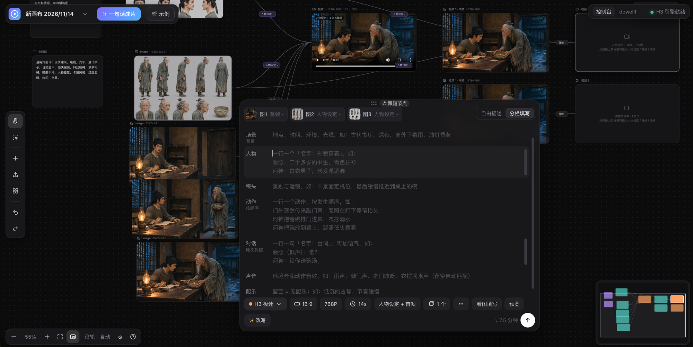

# OneShot

[English](README.en.md)

[](LICENSE)

OneShot 是一个可自行部署的 AI 视频创作工作台。你可以从一句话生成剧本、角色设定和分镜，也可以把已有的图片、视频和文案放到画布上，逐镜生成、修改并剪辑成片。

平台支持本地运行 MiniMax-H3 和 H3-Image，也可以通过 Web 控制台配置第三方模型服务、管理账号和查看任务。

在登录页、画布右上角或控制台可切换中文和英文。语言偏好保存在当前浏览器。



## 本地启动

在仓库根目录使用 Python 3.12 启动 Web 服务。

```bash
python3.12 -m venv .venv
.venv/bin/python -m pip install -r requirements-web.txt
.venv/bin/python server.py
```

打开 `http://localhost:8190` 创建首个管理员，再到「控制台」配置第三方模型。本地生成需要配置 GPU 引擎。 [H3 BF16、H3-Image 和 INT8 ConvRot 的 Linux 部署](docs/deployment.md)

## 开始创作

1. 打开「一句话成片」创建分镜，或把已有素材拖入画布。
2. 点击顶部「资产库」保存角色设定图、场景或背景资料。用「上传素材」导入文件，或用「从画布收录」保存已有内容。
3. 在创作助手或图片、视频提示词中输入 `@`，按名称、别名或标签选择资产。例如，选中 `@林森` 后输入「走进书店」，生成会使用角色的设定和默认参考图。助手也可以检索并选用相关资产。生成结果会进入资产的历史记录，默认参考图由用户指定。
   也可在 `@` 菜单打开个人或团队文件夹，勾选要使用的素材后一次插入引用。
4. 在剪辑台排列镜头、添加字幕和声音，导出成片。

## 主要功能

- 从一句话生成剧本、角色参考和分镜，逐镜生成后剪辑成片。
- 在画布上连接指定版本的图片、视频和音频，用首帧、中帧和尾帧约束单镜头。
- 将世界观、角色设计和对话存入资产库，再用 `@` 引用。
- 使用创作助手在画布中规划和编辑，在剪辑台编排镜头、标题、字幕和声音。

[完整功能与外部助手接入](docs/features.md)

## 架构

```
浏览器 ──▶ server.py（aiohttp，:8190）── 账号、项目、任务、路由、剪辑渲染（PyAV）
              │
              ├─▶ engine/service.py（:8189，本机）── H3 引擎：diffusers 运行完整 MiniMax-H3 / H3-Image
              ├─▶ llama-server（:8191，按需）── Qwen3.5-9B 写剧本、改写、看图
              ├─▶ oneshot/editing/tts_worker.py（CPU）── Kokoro 配音
              └─▶ 第三方 API（oneshot/providers/remote.py）
```

| 文件 | 内容 |
|---|---|
| `server.py` / `oneshot/app.py` | 启动入口、Web 应用装配和后台服务生命周期 |
| `oneshot/web/routing.py` | HTTP 路由清单，处理函数位于各业务模块 |
| `oneshot/generation/requests.py` / `oneshot/generation/jobs.py` | 生成预览与提交、任务状态和恢复 |
| `oneshot/generation/queue.py` | 查询生成队列状态和预计完成时间 |
| `oneshot/generation/reference.py` / `oneshot/generation/reference_prompts.py` / `oneshot/generation/reference_media.py` | 视频参考路由与预览、提示词绑定、固定素材校验 |
| `oneshot/config.py` | 定位项目根目录、数据目录、模型与静态文件 |
| `oneshot/canvas/board_store.py` | 画布编号与数据校验、JSON 读取、原子写入 |
| `oneshot/web/auth.py` / `oneshot/storage/db.py` | 多人账号（scrypt）、会话、SQLite（服务、路由、任务），API Key 用 Fernet 加密存储 |
| `oneshot/providers/catalog.py` / `oneshot/providers/remote.py` | 服务目录与能力路由；第三方生图 / 视频 / 配音 / 音乐适配器 |
| `engine/h3engine.py` / `engine/h3_checkpoint.py` | 完整 H3（31B BF16）的推理、权重流式上卡、检查点读取和 turbo LoRA 合并 |
| `engine/service.py` | 引擎服务：单 GPU 队列、进度、取消、视频 / 图片模型按需切换 |
| `oneshot/generation/rewriter.py` / `oneshot/generation/fields.py` / `oneshot/generation/tools.py` | 提示词改写与分栏合成、分镜、反推、拉片、宫格、拼接 |
| `oneshot/editing/image_editor.py` / `static/editing/image-editor.js` | 图像编辑、选区上下文、扩图与遮罩合成、历史版本界面 |
| `oneshot/assistant/agent_chat.py` / `oneshot/assistant/chat_service.py` / `static/assistant/agent-chat.js` | 助手路由、持久化会话与任务队列、聊天面板 |
| `oneshot/assistant/agent_editing.py` / `oneshot/assistant/agent_video.py` | 图像编辑与视频工具入口，按固定素材版本执行 |
| `oneshot/editing/video_remake.py` / `oneshot/editing/video_matte.py` / `static/editing/video-remake.js` | 原片分析、角色替换、局部合成、镜头审核与保留原声导出 |
| `oneshot/memory/creative_memory.py` / `oneshot/memory/memory_generation.py` / `static/memory/asset-library.js` | 资产库入口、固定素材版本与生成上下文、资产库界面 |
| `oneshot/editing/render.py` | 成片渲染（转场、字幕、配乐压低、旁白） |
| `oneshot/web/local_admin.py` / `engine.sh` | 本地部署页：GPU / 内存 / 磁盘、服务启停、模型文件 |
| `static/index.html` / `static/canvas/` | 工作台页面结构，画布布局、节点、导航和工作流样式 |
| `static/canvas/canvas.js` / `static/canvas/canvas-persistence.js` / `static/canvas/canvas-history.js` | 画布共享状态、按版本保存、撤销与重做 |
| `static/generation/canvas-generation.js` | 画布生成参数、任务轮询和节点版本更新 |
| `static/canvas/canvas-import.js` / `static/memory/canvas-asset-drawer.js` | 文件导入和画布素材抽屉 |
| `static/canvas/canvas-projects.js` | 画布切换、示例及工作台启动 |
| `static/generation/storyboard-node.js` / `static/editing/film.js` / `static/generation/wizard.js` | 分镜脚本节点、剪辑台、一句话成片 |

浏览器通过 `/api/board/{id}` 保存画布，助手完成工具操作后也写入同一份画布。浏览器保存时检查版本号，助手把工具结果和画布修改一起写入，避免重复执行。

图片和视频请求汇入生成路由，任务接口统一返回进度和结果。手动生成由画布更新节点，助手发起的任务由后台更新节点。资产库单独保存角色设定、参考图和生成草稿，定稿时才更新默认参考。

## 验证

[回归命令](AGENTS.md#验证与审查) · [验收历史与待验证项](docs/verification.md)

## 许可

OneShot 项目代码和项目文档采用 [MIT 许可证](LICENSE)。

MiniMax-H3 与 H3-Image 的模型权重遵循 MiniMax H3 Community License。随仓库分发的第三方组件沿用各自的许可证，相关许可文件见 [`static/vendor/`](static/vendor/)。
